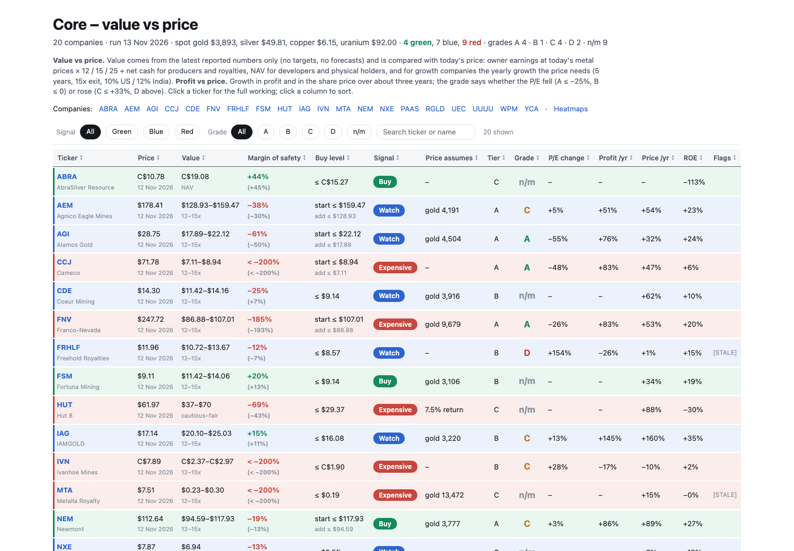
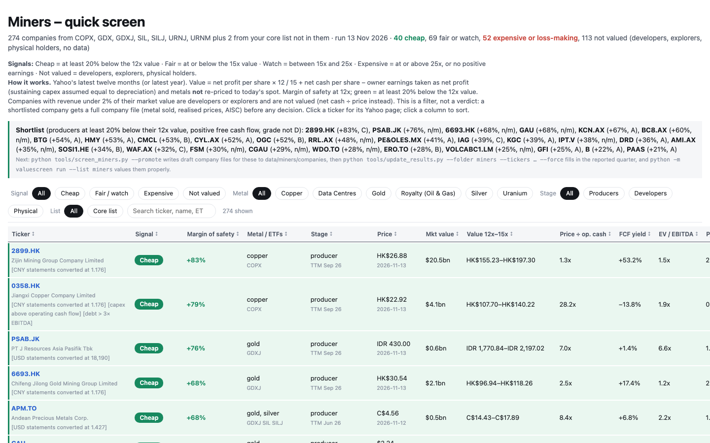
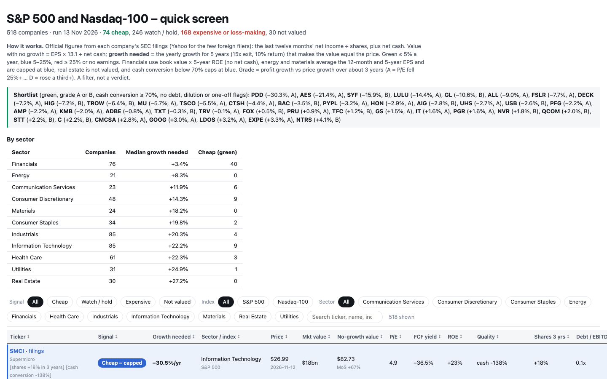
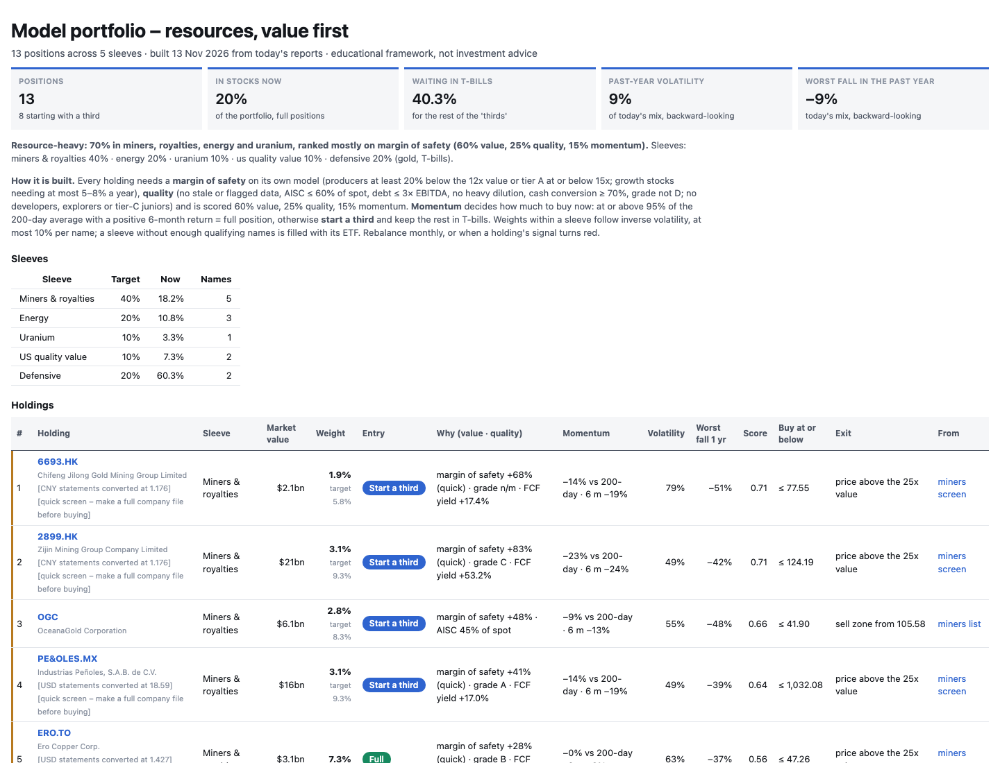

# Value Screener

Is a share cheap or expensive right now? Value vs price, the Rick Rule way: each company is valued only from its
latest results – no forecasts, no analyst targets – and that value is compared with today's share price. It covers
miners, oil and gas, tech and Indian (Nifty) companies; miners are also re-priced to today's metal prices.

Every run writes one HTML report per list: a sortable summary table, then a section per company with its signal, buy
levels, charts and the full calculation, plus a grade for whether profits have kept up with the share price. A flag
shows whenever the data is out of date.

**Contents:** [Latest reports](#latest-reports) · [How to read a report](#how-to-read-a-report) ·
[Quick start](#quick-start) · [Every time](#every-time) · [Screening a big list](#screening-a-big-list-first-nifty-50-and-other-nse-indexes) ·
[Screening the miners](#screening-all-the-miners-etf-holdings) · [Keeping the data current](#keeping-the-data-current) ·
[Adding a company](#adding-a-company) · [Models](#models) · [Signals and zones](#signals-and-zones) ·
[Publishing](#publishing-the-reports) · [Code map](#code-map)

## Latest reports

| List | Report (read this) | Profit vs price PDF |
|---|---|---|
| Core | [core.html](https://vijayvadapalli.github.io/value-screener/reports/core.html) | [core-profit-vs-price.pdf](https://vijayvadapalli.github.io/value-screener/reports/core-profit-vs-price.pdf) |
| Tech | [tech.html](https://vijayvadapalli.github.io/value-screener/reports/tech.html) | [tech-profit-vs-price.pdf](https://vijayvadapalli.github.io/value-screener/reports/tech-profit-vs-price.pdf) |
| Oil & gas | [oil.html](https://vijayvadapalli.github.io/value-screener/reports/oil.html) | [oil-profit-vs-price.pdf](https://vijayvadapalli.github.io/value-screener/reports/oil-profit-vs-price.pdf) |
| Miners – full valuations | [miners.html](https://vijayvadapalli.github.io/value-screener/reports/miners.html) | [miners-profit-vs-price.pdf](https://vijayvadapalli.github.io/value-screener/reports/miners-profit-vs-price.pdf) |
| Miners screen (~270) | [miners-screen.html](https://vijayvadapalli.github.io/value-screener/reports/miners-screen.html) | – |
| S&P 500 + Nasdaq-100 screen | [us-screen.html](https://vijayvadapalli.github.io/value-screener/reports/us-screen.html) | – |
| Model portfolio – balanced | [model-portfolio.html](https://vijayvadapalli.github.io/value-screener/reports/model-portfolio.html) | – |
| Model portfolio – resources, value first | [model-resources.html](https://vijayvadapalli.github.io/value-screener/reports/model-resources.html) | – |
| Nifty 50 | [nifty50.html](https://vijayvadapalli.github.io/value-screener/reports/nifty50.html) | [nifty50-profit-vs-price.pdf](https://vijayvadapalli.github.io/value-screener/reports/nifty50-profit-vs-price.pdf) |

Each run replaces these with the newest version, so the links never change; the date is inside each report.

## How to read a report


*The core list report: value against price for each company, its buy level, signal, tier and profit-vs-price grade. Click a ticker for the full working.*

- **Signal colour.** Green = cheap enough to buy or add · blue = watch or hold · red = expensive, or no reliable value.
  The exact thresholds for each kind of company are under [Signals and zones](#signals-and-zones).
- **Grade A–D.** Has the share price run ahead of profits over about three years? A = profits clearly outran the price,
  D = the price ran well ahead. See [Profit growth vs price growth](#profit-growth-vs-price-growth).
- **STALE.** The results or the price are too old to trust. A stale company never shows as green.
- **[flags]** in the comments point at things to check yourself: one-off quarters, cyclicals, high costs, conglomerates.

Start with the summary table: click a column to sort, filter by signal or grade, and click a ticker to jump to that
company's section.

### Words used in the reports

| Term | In plain words |
|---|---|
| **Price** | What one share costs on the stock market today (the last closing price). |
| **Value** | What one share is worth from the business's own figures: the cash it earns for its owners each year × a multiple, plus the cash it holds after paying off debt. This tool works it out; the market does not. |
| **Margin of safety** | How far the price is below the value. 30% means you pay 70 for something worth 100. The bigger, the more room for mistakes. |
| **Buy level** | The price at which the signal would turn green. |
| **Price assumes** | For growth stocks: how fast profits must grow each year for today's price to make sense. Low = cheap, 25%+ = the market expects a lot. |
| **EPS** | Earnings per share: the company's profit for the year divided by the number of shares. |
| **P/E** (price ÷ earnings) | How many years of today's profit you pay for. P/E 15 = price is 15 × a year's profit per share. Lower is cheaper, if profits hold up. |
| **P/E change** | Whether shares got dearer or cheaper over about three years compared with profits. It drives the A–D grade. |
| **ROE** (return on equity) | Profit as a % of the money the shareholders have in the business. 15–20%+ a year is a good business; under 10% is weak. Banks are valued on it. |
| **Price ÷ book** | Price compared with the company's net assets per share (its book value). Used for banks and insurers. |
| **Owner earnings** | Profit plus depreciation, minus the spending needed just to keep the business running: the cash an owner could take out. |
| **Net cash** | Cash minus debt. Negative means more debt than cash. |
| **Multiple (12x / 15x / 25x)** | How many years of owner earnings a share is worth: 12x = cautious, 15x = fair, 25x = expensive. |
| **Cash conversion** | Cash the business really collected ÷ the profit it reported, over 5 years. Under 70% means the profit is not turning into cash. |
| **FCF yield** | Free cash flow (cash left after all spending) as a % of the share price. Negative = spending more than it earns. |
| **NAV** | Net asset value: for a developer, what its mine project is worth; for a physical trust, the metal it holds. |
| **AISC** | All-in sustaining cost: what a miner spends to produce one ounce or pound, all costs included. |
| **Tier A / B / C** | How much the business is trusted (A = best). Tier A gets a looser buy rule. |
| **Cyclical** | Profits swing with prices (oil, metals, cement, autos), so a cheap-looking year may be a peak. Capped at blue. |

ROE is shown in each company's "Profit growth vs price growth" box: the latest twelve months from Yahoo, or a 3-year
average from Screener.in for Indian companies. The Nifty v2 valuation of banks uses a 5-year average, shown under key
figures.

The rules follow the Valuation Playbook (Nov 2026); `PROJECT_INSTRUCTIONS.md` has them in full, ready to paste into a
Claude Project. `docs/Value_Screener_Design.pdf` has the original requirements and formulas.

## Quick start

```bash
cd value-screener
python3 -m venv .venv                     # first time only
source .venv/bin/activate                 # every new terminal (Windows: .venv\Scripts\activate)
pip install -r requirements.txt           # first time only
pip install yfinance beautifulsoup4 lxml  # first time only: prices, profit-vs-price figures, Nifty data
python -m valuescreen validate            # checks every company file
```

Your prompt shows `(.venv)` while the environment is active. All `python` and `pip` commands in this README assume it
is active. In VS Code, also pick `.venv/bin/python` under **Python: Select Interpreter** so the editor and Run button
use it.

## Every time

Share prices update after each market closes – for US listings that is about 9 pm UK time; before that you get the
previous day's close.

```bash
source .venv/bin/activate

# 1. share prices into the company files
python tools/update_prices.py                    # core, watchlist, tech, oil (data/companies)
python tools/update_prices.py --folder nifty50   # Nifty 50

# 2. reports: one HTML (+ PDFs) per list (dated copies in output/, the latest in reports/)
python -m valuescreen run --list core --live        # --live also fetches today's gold, silver and copper
python -m valuescreen run --list tech
python -m valuescreen run --list oil
python -m valuescreen run --list watchlist
python -m valuescreen run --list nifty50            # first run each day ≈ 4–5 min (Screener.in), then cached

# 3. read them
open reports/core.html                              # Windows: start reports\core.html
open reports/tech.html
open reports/nifty50.html
```

Uranium has no free price feed: set `spot.uranium` in `config.yaml` when it moves. To rerun a past day, pass
`--asof 2026-11-04` (or set `as_of` in `config.yaml`).

Once a quarter, after Indian results: `python tools/fetch_screener.py nifty50` refreshes the Nifty v2 data.

Other runs:

```bash
python -m valuescreen run --list core --technicals        # adds price vs 200-day average, RSI and MACD (yfinance)
python -m valuescreen run --tickers AEM,NEM,HL --spot gold=4200,silver=55   # a few tickers at chosen metal prices
python -m valuescreen run --all --etf URNM --no-pdf       # every company, ETF look-through, skip the PDFs
python -m valuescreen run --list tech --no-profit         # skip the profit-vs-price figures (no Yahoo calls)
python tools/profit_vs_price.py --list tech               # the profit-vs-price PDF on its own
python -m pytest -q                                       # the tests, incl. reproducing the Nov 2026 reports
```

The tests read a frozen copy of the 4 Nov 2026 data in `tests/fixtures/nov2026/`, so updating the live files in
`data/` never breaks them.

Every run writes dated reports and working files to `output/` (`output/nifty50/` for the Nifty), which git ignores, so
your history stays on your computer. It also copies the latest reports to `reports/` under fixed names
(`core.html`, `core.pdf`, `core-profit-vs-price.pdf`, and the same for each list) – the only reports git
tracks and the site publishes.

What each run writes:

- `<List>_Value_vs_Price_<date>.html` – **the report to read.** One page with both views: a summary table (click a column
  to sort; filter by signal or grade; search by name) where every ticker links to its company section. Each section has
  the headline, the "how to read" cards, the valuation band, charts, key figures, the calculation, the profit-vs-price
  comparison, notes and linked sources, with links back to the summary and to the previous and next company. One file
  with the charts inside, so it opens offline and can be shared as it is.
- `<List>_Profit_vs_Price_<date>.pdf` – the profit-vs-price table for printing (see below).
- `<List>_Value_vs_Price_<date>.pdf` – the value report for printing. Page 1 is the summary table (value columns for producers,
  royalties, developers; a reverse-DCF table for growth stocks), alphabetical, rows tinted by signal and by tier or
  market value. Each company then gets a headline, its "how to read" cards (price, value, margin of safety, buy level),
  the valuation band, the metal-price or growth curve, a heatmap, the calculation with a worked example, key figures,
  assumptions and sources. Bookmarked; footer on every page.

Working files (in `output/`):

- `ranked.csv`, `heatmap_metals.png`, `heatmap_growth.png`, the profit-vs-price cache.
- `signals_log.csv` – appended every run; use it after 4–6 quarters to see whether the BUY zone beat GDX/SIL.
- `runs.json` – each run's key figures, so the next report shows the previous run's figure in (brackets).

## Screening a big list first (NIFTY 50 and other NSE indexes)

Most companies in a big list are not worth a full valuation. Screen them all from free Yahoo data, then do the careful
work only on the shortlist.

```bash
python tools/make_nse_list.py nifty50          # download the constituents into data/lists/nifty50.yaml (also nifty500, niftynext50, ...)
python tools/screen_universe.py nifty50        # rank all of them (about 20 seconds for 50)
python tools/screen_universe.py nifty50 --promote        # also write draft company files for the BUY / WATCH ones
python tools/screen_universe.py nifty50 --promote-all    # ... or for every valued company, flagged ones included
python tools/fetch_screener.py nifty50        # Nifty v2 data from Screener.in for every company (about 4 minutes)
python -m valuescreen validate                 # checks every company folder
python -m valuescreen run --list nifty50       # values the companies that have files
```

**A list keeps its own folders.** The `folder: nifty50` line in `data/lists/nifty50.yaml` means its company files live
in `data/nifty50/companies/` and everything it produces in `output/nifty50/`, apart from your metals and tech
companies in `data/companies/` and `output/`:

| | Metals / tech (default) | NIFTY 50 |
|---|---|---|
| Company files | `data/companies/` | `data/nifty50/companies/` |
| Latest reports (tracked by git, published) | `reports/<list>.html` etc. | `reports/nifty50.html` etc. |
| Dated reports (local history) | `output/` | `output/nifty50/` |
| Working files (`ranked.csv`, `signals_log.csv`, `runs.json`, heatmaps, caches) | `output/` | `output/nifty50/` |
| Screen table and cached Yahoo data | | `output/nifty50/screen_nifty50.csv`, `output/nifty50/screen_cache/` |
| Backups from `update_results.py` | `output/backups/` | `output/nifty50/backups/` |

Commands that take company files also take `--folder nifty50` (`valuescreen run`, `update_prices.py`,
`update_results.py`). A new index list made with `make_nse_list.py` gets its own folder the same way, named after the list.

The screen uses the same growth model as the tech stocks: the no-growth value from the last full year's net income and
net cash, and the growth the share price already assumes. It is deliberately rough:

- **Annual and unadjusted:** Yahoo's last full fiscal year (FY26 to March 2026), not the latest quarter, and total capex
  rather than sustaining capex. Check the FCF yield column: a negative one means capex is eating the earnings.
- **Banks and other financials are skipped.** Owner earnings and net cash don't mean the same thing there, so compare
  P/E and P/B by hand.
- **Suspicious figures are flagged, not shortlisted.** If the year's EPS is far from Yahoo's trailing EPS (a demerger or
  a one-off, like TMPV), the company is listed under "Flagged" for you to check against the filing.
- **Yahoo mislabels some currencies.** Infosys reports in US dollars and is converted; HCLTECH is labelled USD but is
  really rupees and is left alone. The check compares EPS with Yahoo's trailing EPS.
- **Drafts are placeholders.** `--promote` never overwrites a file you already have, marks each draft as unverified, and
  a flagged company's draft starts with a CHECK note (the run table does not show the flag, so read the file or
  the HTML report); your stale-data rule shows it as STALE until `update_results.py` replaces it with a reported quarter. Expect a
  "moved -75%" warning there, because a quarter is about a quarter of a year.

### Nifty v2 – the full valuation

`tools/fetch_screener.py` reads each company's consolidated page on Screener.in (the playbook's source for India) and
writes a `v2:` block into its file: the last 8 quarterly EPS, up to 10 yearly EPS, 5 years of net profit and cash from
operations, book value per share and 5-year ROE. It also updates the price and share count and keeps everything else
(net cash, notes, sources). It waits ~4 seconds between pages and backs off when Screener rate-limits it; re-run
failed tickers with `--tickers`. A new file starts with net cash 0 and a note to add it from StockAnalysis.

The valuation then applies the v2 rules (`valuescreen/v2.py`):

- Per share, 12 months: the last four quarters, after replacing a one-off quarter (more than 2× the median of the other
  seven and 1.6× its neighbours) with its neighbours' average.
- Cyclicals (oil & gas, metals, cement, power, autos, airlines – lists in `config.yaml`): average of the 12-month EPS and
  the 5-year average. Shown blue at most.
- Financials: average of the 12-month EPS and book value × 5-year ROE, no net cash, and price-to-book against the fair
  multiple (5-yr ROE × the no-growth multiple).
- Discounted at 12% (no-growth multiple ≈ 12.1x instead of 13.1x for the US).
- Cash conversion (cash from operations ÷ net profit over 5 years) below 70% caps the signal at blue.
- Conglomerates and finance arms (L&T, M&M, Bajaj Auto, Grasim) and insurers are flagged.

The AI updater (`update_results.py`) also works on these files, but `fetch_screener.py` is the quicker way to refresh
them each quarter. NSE / BSE results filings remain the authority – check the key figures before acting.

## Screening all the miners (ETF holdings)


*The miners quick screen: ~270 companies from seven ETFs, with a shortlist that deserves a full company file.*

A quick first pass over every miner in seven ETFs – which ones deserve a full company file. Kept separate from your
other lists: its own list (`data/lists/miners.yaml`), company folder (`data/miners/companies`) and output (`output/miners`).

```bash
python tools/make_etf_list.py miners GDX GDXJ SIL SILJ COPX URNM URNJ   # the universe (~270 companies); re-run to refresh
python tools/screen_miners.py                  # screen them all (~5 minutes the first time each day, then cached)
open reports/miners-screen.html                # the report
python tools/screen_miners.py --promote        # draft company files for the shortlist, in data/miners/companies
python tools/screen_miners.py --promote BTG,OGC,KGC   # ... or for chosen tickers (existing files are never overwritten)
python tools/update_results.py --folder miners --tickers BTG,KGC --force --dry-run   # fill in the reported quarter
python -m valuescreen run --list miners --live # full valuations of the companies that have files → reports/miners.html
python tools/model_portfolio.py                # the model portfolios then use the full valuation instead of the quick one
```

Promoted so far, filled from their Q3-2026 releases: **BTG**, **KGC** and **OGC**. The full model can differ a lot from the
quick screen, because it counts sustaining capex and re-prices metal to spot. On 13 Nov 2026 B2Gold went from +54%
(quick) to −19% (AISC $2,602/oz, 63% of spot), Kinross from +39% to +19%, and OceanaGold from +52% to +42%.

- **Funds:** GDX and GDXJ (VanEck), SIL and COPX (Global X), SILJ (Amplify), URNM and URNJ (Sprott), read from the fund
  companies' own daily holdings files. One entry per company; its US listing when an ETF holds it.
- **Figures:** Yahoo's latest twelve months (or latest year, flagged). Value = net profit per share × 12 / 15 + net cash;
  owner earnings taken as net profit (sustaining capex assumed equal to depreciation) and metals **not** re-priced to spot.
  Also price ÷ operating cash flow, free-cash-flow yield, EV / EBITDA, price ÷ book, net cash ÷ price, the profit-vs-price
  grade and the 1-year price change. Money in the price currency (statements converted where needed, flagged).
- **Signals:** Cheap = at least 20% below the 12x value · Fair = at or below 15x · Watch = 15–25x · Expensive = 25x or
  more, or no positive earnings · Not valued = developers and explorers (revenue under 2% of market value) and physical
  holders. **Shortlist** = Cheap producers with positive free cash flow and a grade other than D.
- **The core list** (`data/lists/core.yaml`) is shown too, tagged "core" (a "Core list" filter shows only them);
  `--also none` leaves them out, `--also <list>` uses another list. Nothing is written to those files.
- **Yahoo rate limits:** on a list this long Yahoo sometimes blocks for a while. The run then stops fetching, says so,
  and keeps what it has; run it again later and only the missing companies are fetched.

This is a filter, not a verdict – a shortlisted company gets a full company file (metal sold, realised prices, AISC)
and the proper producer valuation before any decision. A draft file starts from Yahoo's figures and is marked DRAFT
until the reported quarter replaces them; any figure the release does not give is written as ASSUMED in `assumptions`.

## Screening the S&P 500 and Nasdaq-100 (SEC figures)


*The S&P 500 / Nasdaq-100 screen: growth needed to justify the price, by sector and company, from SEC figures.*

```bash
export SEC_USER_AGENT="Your Name your.email@example.com"   # once, in ~/.zshrc – the SEC requires a contact in every request
pip install beautifulsoup4 lxml yfinance                    # if not installed yet
python tools/screen_us.py                                   # first run 10–20 minutes, later runs a minute or two
open reports/us-screen.html
```

- **Universe:** the S&P 500 and Nasdaq-100 constituents from their Wikipedia lists (~520 companies, sectors included).
- **Figures:** each company's own SEC filings, from the SEC's bulk "company facts" file (~1–1.5 GB, downloaded once a
  week; `--refresh` forces it). Quarters are worked out from year-to-date figures, Q4 = the year − nine months. Foreign
  filers (ASML, Arm, PDD and a few others file 20-F reports) use Yahoo's figures instead, flagged in the report.
- **Database:** `output/us/us_facts.sqlite` (not committed, rebuildable) holds every stored figure with the date it was
  filed (restatements kept beside the originals), six years of daily prices and splits, and each run's verdicts – the
  base for history charts and back-testing the signals later.
- **Screen:** reverse DCF at 10% (growth needed for 5 years, 15x exit). Financials: average of 12-month EPS and book value
  × 5-year ROE, no net cash, shown with price-to-book against the fair multiple. Energy and materials: average of 12-month
  and 5-year EPS, capped at blue. Real estate: not valued. Quality: free-cash-flow yield, ROE, 5-year cash conversion
  (below 70% caps at blue), share count change over 3 years, debt ÷ EBITDA; and the profit-vs-price grade.
- **Report:** filters by signal, index and sector; a table of the median growth needed by sector (where the market is
  cheap or stretched); a shortlist (green, grade A or B, cash conversion ≥ 70%, no debt or dilution flags); each ticker
  links to its Yahoo page and its SEC filings.

## Model portfolios (value, quality, momentum)


*The resources, value-first model portfolio: sleeves, entry (full or a third), margin of safety, momentum, risk and exit rule for each holding.*

```bash
python tools/model_portfolio.py                      # both profiles, from today's screens (a few seconds)
python tools/model_portfolio.py --profile resources  # just one: balanced | resources
open reports/model-portfolio.html reports/model-resources.html
```

Run the screens first (core, oil and tech lists, `screen_us.py`, `screen_miners.py`); the model portfolios read their
results and fetch only the price history they still need. Educational framework, not investment advice.

| | Balanced | Resources, value first |
|---|---|---|
| Sleeves | US quality value 40% · miners & royalties 25% · energy 10% · uranium 5% · defensive 20% | miners & royalties 40% · energy 20% · uranium 10% · US quality value 10% · defensive 20% |
| Score | 45% value · 35% quality · 20% momentum | 60% value · 25% quality · 15% momentum |
| Names | at most 15 (11 stocks + ETFs) | at most 15 (11 stocks + ETFs) |
| Most per name | 10% | 10% |
| Defensive | gold (IAU) 10% · T-bills (SGOV) 10% | gold 12% · T-bills 8% |

- **Candidates:** full company files first (`data/companies` and the promoted miners in `data/miners/companies`), then the S&P 500 / Nasdaq-100 screen, then the miners quick screen (a company
  in several keeps its most thorough valuation; quick-screen names are flagged "make a full company file before buying").
- **Must pass:** a margin of safety on its own model (green; growth stocks needing at most 8% a year), no stale or flagged
  figures, AISC ≤ 60% of spot, debt ≤ 3× EBITDA and net debt below half the market value, positive free cash flow, no
  heavy dilution, cash conversion ≥ 70%, grade not D. Developers, explorers, lease plays and tier-C juniors are left out.
- **Momentum sets the entry:** at or above 95% of the 200-day average with a positive 6-month return = full position;
  otherwise start a third, the rest waiting in T-bills until the trend turns.
- **Concentrated:** at most 11 stocks per profile (balanced: US 5, miners 3, energy 2, uranium 1; resources: miners 5,
  energy 3, uranium 1, US 2), plus the ETFs, so a portfolio holds at most 15 names, at most 10% each.
- **Sizing:** inverse volatility within each sleeve; a sleeve with too few qualifying names is filled with its ETF
  (SPY, GDX, XLE, URNM). While momentum is weak, many holdings start with a third and the T-bill line can be large
  (about 40–50% in Nov 2026). That is the rule keeping capital safe, not a target. The report shows each holding's market value (US$), volatility, worst fall in the past year, buy level and exit rule,
  the past-year behaviour of today's mix, the next names in line, and why the others were left out.

## Adding companies by hand (oil and gas)

```bash
python tools/add_companies.py oil XOM COP EOG TPL SU.TO CNQ.TO CVE.TO IMO.TO TOU.TO WCP.TO PEY.TO PSK.TO
python -m valuescreen run --list oil
```

Writes a draft `cashflow`-model company file (10x / 13x) from Yahoo's reported statements for each symbol that has no
file yet, and the list `data/lists/oil.yaml`. Owner earnings = operating cash flow excluding working-capital moves − all
capex. The value is ranked on the average of the last four financial years ("normal" prices, like Chevron's file),
because 2026 cash flows include a price spike; the latest twelve months are kept in `earnings` for reference. Canadian
companies use their Toronto listing, so price and results are both in C$. Files are marked DRAFT – check them, or let
`tools/update_results.py` replace them with the latest reported quarter.

## Keeping the data current

| What | How often | Command |
|---|---|---|
| Share prices | before each scan | `python tools/update_prices.py` (add `--dry-run` to preview) |
| Metal prices | before each scan | gold, silver, copper: add `--live` to a run. Uranium, zinc, lead: edit `spot` in `config.yaml` |
| Company results | when a company reports | `python tools/update_results.py --all --check`, then see below |

**Share prices.** `tools/update_prices.py` saves Yahoo's latest close into each company file's `price` block (value, date
and source only). It skips a company if Yahoo has no price, quotes another currency, or the price moved more than 50%,
so check those by hand. It converts London pence to pounds.

**Metal prices.** `--live` fetches gold, silver and copper for that run only and does not save them. Uranium has no free
feed: look up the U3O8 spot price weekly and set `spot.uranium` in `config.yaml`. `as_of: today` there dates the report
and means the stale-data check counts from today.

## Refreshing a company when it reports (about 10 minutes by hand)

`python tools/update_results.py --all --check` lists which companies should have new results out. It costs nothing and
uses the `next_report` date in each file, Yahoo's earnings calendar (needs `lxml`), and the time since the period ended.
Developers and physical trusts never show as due; use `--force` for those after a new study or NAV.

To have an AI draft the update for the due companies, pick a provider:

| | Claude (default) | Gemini |
|---|---|---|
| Install | `pip install anthropic` | `pip install google-genai` |
| Key | `ANTHROPIC_API_KEY` (billed separately) | `GEMINI_API_KEY`, a free key from Google AI Studio |
| Run | `python tools/update_results.py ...` | `python tools/update_results.py --provider gemini ...` |
| Searches with | Claude's web search and page fetch | Google Search (it works from search results and may not open the whole filing) |

```bash
python tools/update_results.py --tickers CDE --dry-run   # the AI searches the web and shows the proposed changes
python tools/update_results.py --tickers CDE             # same, then type y to save (old file goes to output/backups/)
python tools/update_results.py --provider gemini --tickers CDE --dry-run   # the same with Gemini
```

Neither provider is told which sites to use. The prompt asks for the company's own results release or filing, never
analyst estimates, and every changed number must come with a source URL and a quote, shown in the diff. Gemini's free
tier has request limits (check them in AI Studio); if it is rate limited the company is skipped, so retry later. Model
names change: if the default is not found, the error lists the ones that exist, and `--model` or `GEMINI_MODEL` sets one.

It never changes the share price or the ticker, name, sector, model or currency, and it flags numbers that changed
by more than 50% or have no source. Numbers from the web can still be wrong, so check the key figures against the
release before saving.

To do it by hand instead:

1. Open `data/companies/<ticker>.yaml`.
2. From the new results release, update `period` (label, end, reported, next_report), `earnings`, `shares_m`,
   `balance`, `metals` (units sold this period in Moz / Mlb, realised price, AISC), `tax_rate`, `sources`.
3. `python -m valuescreen validate`, then run.

Units: money in millions of the file's `currency` for the period; ounces in Moz and pounds in Mlb per period;
metal prices in USD per oz / lb. `per_year` is 4 for a quarter, 2 for a half, 1 for a year.

## Adding a company

Copy the closest existing file (a producer like `aem.yaml`, a developer like `nxe.yaml`, a physical trust like
`sput.yaml`, a tech stock like `msft.yaml`) and change the numbers. `yahoo:` is the symbol used for live prices
(e.g. `IVN.TO`, `KAP.L`, `PDN.AX`). The price currency can differ from the reporting currency – add the FX rate
to `config.yaml` if it is not there.

## Judgement calls (all in config.yaml)

Spot prices, FX, multiples (12x / 15x cautious and fair, 25x sell), zone thresholds (20% margin of safety for BUY,
AISC ≤ 60% of spot, developer BUY ≤ 0.8 × NAV), DCF settings (10%, 12% for INR, 15x exit, 5 years), the
tiers, market-value shades, the gold stress-test prices, the Nifty v2 industry lists, and how old results (100 days)
and prices (7 days) can be before they are flagged. A STALE company never shows as BUY.

## Models

| `model:` | For | Value |
|---|---|---|
| `producer` | miners, royalty and streaming companies | owner earnings (adj. net income + D&A − sustaining capex; royalties: adj. net income) re-priced to today's metals, × 12 / 15 / 25 + net cash. A company without `metals` (Cameco) keeps its own realised prices. Optional `ltm:` (four quarters) values the last 12 months instead of the latest quarter × 4; optional `cfo` and `capex_total` add free cash flow after all capex. |
| `cashflow` | oil & gas | the same at 10x / 13x |
| `developer` | ABRA, NXE | study NPV at today's metal price × ownership + cash − debt, per share |
| `physical` | Yellow Cake, Sprott | holdings × spot + other net assets |
| `growth` | tech, Nifty 50 | reverse DCF: the growth the price needs; Nifty v2 rules when the file has a `v2:` block |
| `leases` | Hut 8 | each lease's cash after project bonds and tax, discounted, + site value at lease end; cautious / base / fair |
| `liquid` | UEC, UUUU | not valued: liquid assets as a share of market value |

## Profit growth vs price growth

Did the share price run ahead of the company's profits over about three years? For each company: yearly growth in
sales, profit and the share price over the same years, and what that did to the P/E –
`P/E change = ((1 + price growth) ÷ (1 + profit growth)) ^ years − 1`.

| Grade | P/E change | Means |
|---|---|---|
| A | fell 25% or more | profits clearly outran the price |
| B | fell up to 25% | profits a little ahead |
| C | rose up to a third | roughly in line |
| D | rose more than a third | the price ran ahead of profits |
| n/m | – | a loss at either end, missing figures, or valued on assets (developers, physical holders, leases) |

Indian companies use Screener.in's 3-year compounded growth (net profit). Everything else uses Yahoo Finance statements
from the financial year about three years back to the latest twelve months (diluted EPS, so buybacks count); if that year
was a loss it starts from the next profitable year (about two years). Prices are in the exchange's currency, sales and
profits as the company reports them – growth rates and the P/E change do not depend on the currency. Figures are cached
per list and day in `output/<folder>/profit_vs_price_cache/`. Profits include one-offs: check big jumps in the filing.

To see your position values, add a share quantity to `data/lists/core.yaml`, e.g. `{ticker: FNV, quantity: 35}`;
the profit-vs-price report then shows each position's value in the share's own currency.

## Signals and zones

Green = buy / start a position, blue = watch / hold, red = expensive or no valid value.

| Zone | Producers / royalty | Developers, leases | Physical trusts | Growth (implied growth) |
|---|---|---|---|---|
| BUY | tier A: price ≤ 15x value (start), ≤ 12x (add). Tiers B, C: margin of safety ≥ 20% at 12x. AISC ≤ 60% spot | ≤ 0.8 × NAV (cautious value) | ≤ 0.85 × NAV | ≤ 5%/yr (≤ 10% tier A) |
| WATCH | 0–20% | 0.8–1.0 × | 0.85–1.0 × NAV | 5–10% |
| HOLD | between | 1.0–1.5 × | 1.0–1.1 × NAV | 10–25% |
| SELL / write calls | price ≥ 25x owner earnings | ≥ 1.5 × | ≥ 1.1 × NAV | ≥ 25% |

A cheap cyclical, or cash conversion below 70%, is capped at blue. Comments carry [flags] for stale results, old or
undated prices, high costs, one-off quarters, cyclicals, conglomerates and insurers.

## Optional packages

`requirements.txt` has the core packages, including `reportlab` for the PDF report. The report uses the Inter
typeface, included in `valuescreen/fonts/` (SIL Open Font License). Install these only if you use the feature:

| Package | Needed for |
|---|---|
| `yfinance` | `--live` prices, `--technicals` and `tools/update_prices.py` |
| `beautifulsoup4`, `lxml` | `tools/fetch_screener.py` (Nifty v2 data from Screener.in) |
| `lxml` | Yahoo's earnings calendar in `tools/update_results.py` |
| `anthropic` | Claude drafting updates in `tools/update_results.py` |
| `google-genai` | Gemini drafting updates in `tools/update_results.py --provider gemini` |

## Publishing the reports

`reports/` holds only the latest report for each list, so committing it publishes just those:

```bash
git add reports/
git commit -m "Reports 13 Nov 2026" && git push
```

GitHub Pages (Settings → Pages → Deploy from a branch → main, / root) serves them at the links under "Latest reports"
about a minute after the push. Each push replaces the previous version on the site; older versions stay only in the git
history and in your local `output/` folder. Each commit of all lists adds about 30 MB to the repository (the Nifty HTML
and PDF are ~10 MB each), so commit when something has changed rather than after every run. The repository is public,
so the published reports – including the core list – can be seen by anyone. (Do not move the HTML reports to Git
LFS: GitHub Pages cannot serve LFS files.)

## Code map

```
valuescreen/loader.py      read and check company, list and config files (also last-12-month earnings, tiers)
valuescreen/models.py      the valuation models; leases.py (Hut 8) and v2.py (Nifty v2 rules) beside it
valuescreen/rules.py       zones, signals, buy levels, flags, stale checks
valuescreen/engine.py      runs models + rules over a set of companies
valuescreen/wording.py     what the report says: headlines, steps, worked examples, key figures, cards
valuescreen/charts.py      the charts; style.py holds the fonts and colours
valuescreen/html_report.py the combined HTML report;  pdf.py the value PDF;  profit_vs_price.py the profit-vs-price method + PDF
valuescreen/growth_data.py profit-vs-price figures from Yahoo / Screener.in (screener.py reads Screener pages)
valuescreen/report.py      ranked CSV, signal log, cross-company heatmaps
valuescreen/technicals.py  200-day average, RSI, MACD;  history.py  previous-run figures
valuescreen/miner_screen.py, etf_holdings.py   the miners quick screen and the ETF holdings it starts from
valuescreen/model_portfolio.py   the model portfolios: candidates from every screen, scoring, sleeves, sizing, report
valuescreen/us_screen.py, us_universe.py, us_fundamentals.py, sec.py, factsdb.py   the S&P 500 / Nasdaq-100 screen:
                           index lists, SEC download, figures from filings, the SQLite database
tools/                     update_prices, update_results (AI), fetch_screener, profit_vs_price, make_etf_list, screen_miners, screen_us, model_portfolio,
                           screen_universe, make_nse_list
```

Educational framework, not investment advice.
