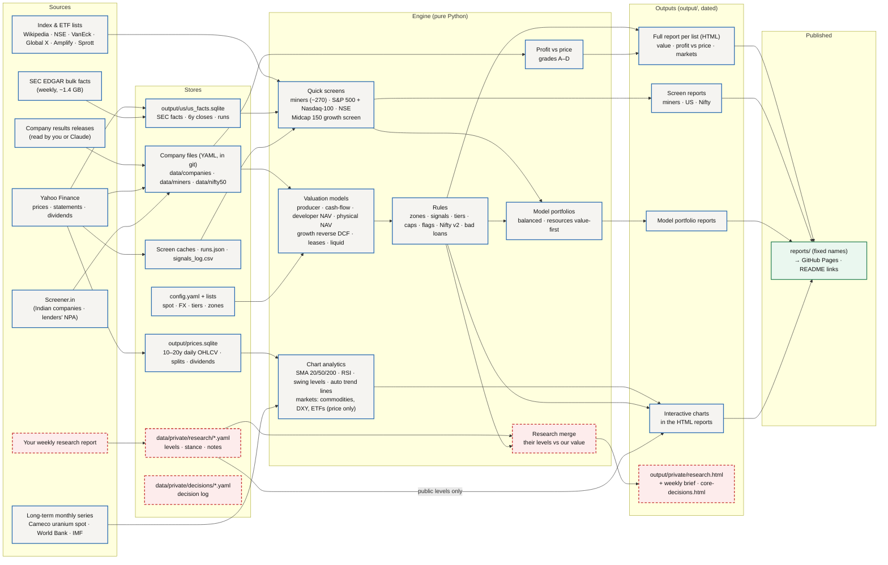
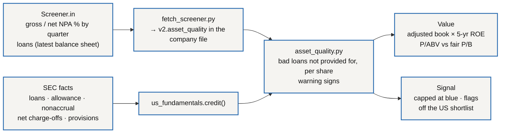
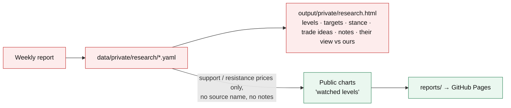
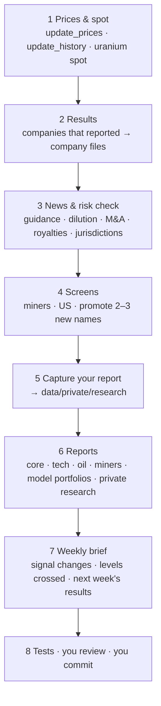
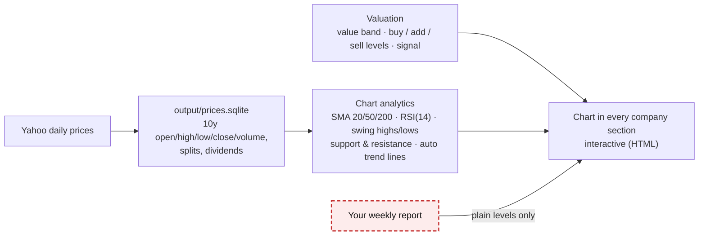

# Value Screener – architecture

What the system does, how the parts fit together, what is built and what is next. Updated 14 Nov 2026.
The rules are in [PROJECT_INSTRUCTIONS.md](../PROJECT_INSTRUCTIONS.md); how to run everything is in the
[README](../README.md); how companies are valued, in plain English, is in
[Valuation_Overview.pdf](Valuation_Overview.pdf) (short) and [Valuation_Guide.pdf](Valuation_Guide.pdf) (detailed).

**Legend:** solid boxes are built and in use · dashed boxes are agreed and next · the red area is private and never
leaves your machine (git ignores it and the publish step refuses it).

## 1. The idea in one line

Value from the latest **reported** numbers (no forecasts, no targets), compared with today's **price** – the Rick Rule
way – with a margin of safety before buying, and the same rules applied every time.

## 2. The whole system

## 3. Layers

### Sources
| Source | What it gives | Used by | How often |
|---|---|---|---|
| Company results releases | production, realised prices, AISC, earnings, D&A, sustaining capex, cash, debt | full company files | each quarter, via `update_results.py` or in chat |
| Yahoo Finance (yfinance) | prices, statements, dividends, FX | prices, quick screens, profit vs price, model portfolios, price history (next) | daily |
| SEC EDGAR bulk "company facts" | official US filings, incl. lenders' loans, allowance, nonaccrual loans, charge-offs | S&P 500 / Nasdaq-100 screen | weekly |
| Screener.in | Indian consolidated figures (Nifty v2), 5-year growth, the shareholding pattern (promoters, FIIs, DIIs); for lenders, quarterly gross / net NPA % (standalone page for banks) and loans | Nifty 50 and Midcap 150 company files | quarterly |
| Wikipedia, NSE, ETF providers | index and ETF membership | universes for the quick screens | when refreshed |
| Cameco uranium price page; World Bank, IMF (`data/longterm`) | month-end uranium spot from 1988; monthly gold, silver from 1960 | Markets charts (uranium), long-term charts in the research report | weekly (uranium, in `/weekly`) |
| Your weekly research report | support / resistance, targets, stance, notes | private research report; plain levels on public charts | weekly, **private** |

### Stores
| Store | Contents | In git? |
|---|---|---|
| `data/companies/*.yaml`, `data/miners/companies`, `data/nifty50/companies` | one file per company: the reported quarter, shares, balance, metals, sources, assumptions | yes |
| `data/lists/*.yaml`, `data/etfs/*.yaml`, `config.yaml` | lists (incl. price-only markets), ETF look-throughs, spot, FX, tiers, zones, multiples | yes |
| `data/longterm/*.csv` | monthly gold and silver (World Bank), uranium (IMF), uranium spot (Cameco) | yes |
| `output/us/us_facts.sqlite` | SEC facts with filing dates (point-in-time), 6 years of closes, splits, each run's verdicts | no (rebuildable) |
| `output/*/screen_cache`, `runs.json`, `signals_log.csv` | cached Yahoo figures, previous-run figures, signal history | no |
| `output/prices.sqlite` | 10 years of daily open/high/low/close/volume, splits, dividends, currency – core, tech, oil, promoted miners | no (rebuildable, ~12 MB) |
| `data/private/research/<date>.yaml` | each weekly report captured per stock and metal | **no – private** |

### Engine (`valuescreen/`)
| Module | Job |
|---|---|
| `loader.py`, `settings.py` | read and validate company files, lists, config (each model checks its own fields); last-12-month earnings; publish to `reports/`. `settings.py`: FX and tiers – the lookups the models need, kept apart from file reading |
| `types.py` | the shape of a valuation result as typed dicts – for editors and type checkers; a test fails if the engine produces an undeclared key |
| `models.py`, `leases.py` | the valuation models (producer / streamer / royalty, oil cash-flow, developer NAV, physical NAV, growth reverse DCF at 10% US / 12% India, contracted leases, liquid assets) |
| `rules.py`, `v2.py` | zones (a band plus details; the text is written from them), signals (green / blue / red), buy and add levels, flags, stale-data check; Nifty v2 earnings data |
| `growth_screen.py` | the growth screen – Dr. Amit Gupta's filter and rules – one set of rules (`judge`) with an adapter per market: India (Midcap 150, Nifty 50 – P/E ≤ 15, EPS growth ≥ 20% over 5 and 3 years, 5-year return ≥ 12%, promoter flags) and the US (a little more liberal – P/E ≤ 18, growth ≥ 15%, return ≥ 10%, insiders shown); shortlist and near misses at the top of the report. `apply_filters` adds the settings panel's default switches (`growth_screen.default_filters`: promoter rule, no government-owned, the list only, no cyclicals) so the page, its answer and the backtest read as the panel does at its defaults. `quality_figures` / `quality_guards`: the quality check (ROE and debt to equity from `v2.balance_annual`, financials apart) – off by default, on for the Nifty 50 via its `screen_rules` |
| `buy_zone.py` | core's buy-zone and review lists: valuation green, price ≤ 5% above the nearest support (auto or watched), 14-day RSI < 30 – all three = buy zone, two = review – from the chart data; the private decision log (`data/private/decisions/<list>.yaml`, public entries only on the report) |
| `resource_screen.py` | the resource screen for core, oil and miners: price ≤ fair value (15x owner earnings at spot), still ≤ it with the metal 20% lower, volume growth ≥ 5% (revenue growth less the metal-price change), ≥ 10% a year over a 5-year hold; NAV models on their NAV rules |
| `price_cases.py` | price cases for lists with `price_cases: true` (core): the value at the fixed metal prices in `config.yaml` `price_cases:` – the company's own model re-run with one metal moved, the others at spot. 12x / 15x / 25x for producers and royalties (each metal ≥ 15% of metal revenue), NAV for developers and physical holders. A company whose realised price lags spot (Cameco) carries a `price_sensitivity:` block – its own MD&A table of realised price at each spot price, pounds sold and bought, royalty, tax – used by `models.curve_delta_ps`, which is zero at today's spot. Nothing for companies without a sensitivity in their file (Ivanhoe, oil). Shown on the company page as "assumption, not reported"; the trailing value stays the headline |
| `forward.py` | forward estimates for companies whose file has a `forward:` block (Cameco first): owner earnings for coming years built line by line from the company's own outlook, capital plan and contract table (pre-tax lines, tax, after-tax lines; uranium gross profit from its contract table at today's spot), value at 12x / 15x / 25x, the `checks:` against reported figures and consensus, and analyst consensus EPS as a reference row. Run in `engine.run`; shown on the company page (`html_report._forward`); never changes the headline value, signal or screen |
| `backtest.py` | how the growth screen's rules did: picks 5, 4, 3 and 2 years ago with only the data known then, returns since against all screened and the index, and the growth-of-1 curve for the chart. India (`run`): the company files, returns with dividends, Nifty 50 / Midcap 150. US (`run_us`): each company rebuilt from the SEC figures filed by the start date, the price on the share basis of then, price-only returns against the S&P 500 (US screen page) or the Nasdaq-100 (tech). `python -m valuescreen backtest --list X` and a section after the screen (`html_report.backtest_html`, chart `charts.backtest_curve`) |
| `us_pages.py` | pages for the interesting US companies (shortlist, near misses, green signals): the screen's working, SEC figures, a 10-year EPS chart and a 20-year price chart with our value lines |
| `screening.py` | the screening rules, one copy for the full valuation and the US / miners screens: earnings basis (cyclical, financial, history break), growth and multiple bands, blue caps, colours |
| `asset_quality.py` | bad loans at banks and other lenders: adjusted book value, warning signs that cap at blue (India and US) |
| `profit_vs_price.py`, `growth_data.py`, `screener.py` | profit growth vs price growth and its A–D grade; Yahoo and Screener.in fetching, or (`profit: local`, Midcap 150) the company files' EPS and the stored prices with no downloads |
| `miner_screen.py`, `etf_holdings.py` | miners quick screen from ETF holdings |
| `us_screen.py`, `us_fundamentals.py`, `us_universe.py`, `sec.py`, `factsdb.py` | S&P 500 / Nasdaq-100 screen from SEC figures, with its database (facts keep their `filed` date for the backtest; every split since listing, loaded once per ticker by `tools/screen_us.py`) |
| `model_portfolio.py` | candidates from every screen, value / quality / momentum scores, sleeves, sizing, report |
| `technicals.py`, `prices.py`, `history.py` | 200-day average, RSI, MACD; live prices; previous-run figures |
| `pricedb.py` | the price-history database: bars, splits and dividends, weekly / monthly resampling |
| `chart_levels.py`, `price_chart.py` | SMA 20/50/200, RSI(14), swing highs and lows, support / resistance, automatic trend lines (incl. channel edges and two-touch lines); the chart data for the HTML report |
| `markets.py`, `longterm.py` | price-only list entries (gold, silver, uranium, WTI, DXY, ETFs): price facts and charts for the Markets section; the long-term monthly series and the Cameco uranium refresh |
| `research.py` | private: the weekly capture's levels, rules and stance against today's price and our valuation; trend lines and chart patterns; the private report |

### Outputs (`valuescreen/`)
| Module | Output |
|---|---|
| `html_report.py` | the full report per list: summary table, markets (price only), company sections, profit vs price, links; optional parts passed as one `ReportExtras`. Big lists (`layout: pages`: Nifty 50, Midcap 150) are multi-page – a summary page plus `<list>/<ticker>.html` per company and shared files in `assets/`, published with `loader.publish_dir`. Lists with the India growth screen open in three tabs (`assets/report.js`, the tab in the address): *Dr. Gupta's screen · N* (screen, answer, backtest; N passes), *Value vs price* (summary table, profit vs price) and *Growth priced in* (the reverse DCF) |
| `page.py`, `assets/` | the page shell every report shares (value report, screens, model portfolios, research) and all their CSS and JavaScript as files; every page ends with the disclaimer and copyright line (`page.legal_footer`). Multi-page reports link the shared files with a content hash (`assets/report.css?v=…`), so a browser never pairs a new page with a cached old stylesheet (GitHub Pages lets them keep it 10 minutes) |
| `assets/screen.js` | the growth screen's settings panel (Nifty 50, Midcap 150, tech, US screen page – sliders): recomputes the screen in the browser exactly as `growth_screen.py` does, keeps the settings in the address, writes the funnel sentence, the five rules (and their folded summary line), the near-miss line and the answer for the settings set, and re-picks the backtest from the figures then (`html_report.backtest_data`) – both tested against Python in Node |
| `kinds/` | one class per valuation model – producer (and cash-flow), developer, physical, growth, leases, liquid – owning its zone, headline, calculation steps, worked example, key figures, cards, main chart, heatmap grid and price-chart lines; the reports ask the model instead of checking which one it is |
| `charts.py`, `plot.py`, `fmt.py`, `style.py`, `wording.py` | the shared charts (band, heatmap, EPS history) and chart basics; text formatting; one look (Inter, palette); the shared words and notes |
| `report.py` | ranked CSV, signal log, heatmaps |
| `html_report.chart_block` + `vendor/` | per company: RSI on top, candles (D / W / M, 6M–10Y), SMA 20/50/200, nearest auto support / resistance (all on request) and trend lines, value / buy / add / sell lines, E / D / S markers (Lightweight Charts, Apache 2.0) |

### Commands (`tools/` and `python -m valuescreen`)
| Command | Does |
|---|---|
| `python -m valuescreen run --list <core/tech/oil/miners/nifty50> --live` | full valuations → one HTML report (no PDFs), published to `reports/<list>.html` |
| `update_prices.py`, `update_results.py`, `fetch_screener.py`, `add_companies.py` | keep company files current |
| `screen_miners.py [--promote]`, `screen_us.py`, `screen_universe.py`, `make_etf_list.py`, `make_nse_list.py` | quick screens and their universes |
| `model_portfolio.py` | the two model portfolios |
| `update_history.py` | load and update the price history |
| `research.py` | build the private research report (`output/private/research.html`) |
| `decide.py` | add an entry to a list's private decision log (`--public` to show it in the report) |
| `weekly.py` · `/weekly` | the whole routine and the weekly brief; the Claude Code skill adds results updates, the news check and the research capture |

## 4. Banks and other lenders

A lender's book value and earnings are only as good as its loans, so financials get one more step after the v2 rule
(average of 12-month EPS and book value × 5-year ROE, no net cash):

| | India (Nifty 50) | US (S&P 500 / Nasdaq-100 screen) |
|---|---|---|
| Bad loans taken off book | net NPA % × loans | nonaccrual loans − allowance, if positive (CECL already reserves lifetime losses) |
| Warning signs (cap at blue) | net NPA > 2%, gross NPA > 5%, coverage < 60%, gross NPA up > 0.5 pts in 4 quarters | nonaccrual > 2% of loans, allowance < nonaccrual, net charge-off rate up > 50% on a year earlier |
| Data quirks | banks fill NPA rows only on the standalone page; Screener's "Loans n Advances" is used only when ≥ 40% of assets, else Other Assets − cash (an upper bound) | not every bank tags nonaccrual loans or charge-offs (e.g. WFC, AXP); missing figures mean no check, not a pass |
| Thresholds | `asset_quality` in `config.yaml` | same block |

Capital ratios (CAR / CET1) are in neither source, so they are still checked by hand.

## 5. Public and private

- `data/private/` and `output/private/` are in `.gitignore`; `loader.publish` refuses any path under them.
- On public charts only plain support and resistance prices appear, as dashed "watched levels" with no source named.
  Targets, stops, stance, trade ideas, thesis and the source stay private. A level can be forced either way with
  `public: true / false` in the weekly file.
- The decision log (`data/private/decisions/`) is private; only entries marked `public: true` appear in the core
  report. The full log goes to `output/private/<list>-decisions.html`.
- Holdings quantities and cost basis, if ever added, are private too.

## 6. The weekly routine (`tools/weekly.py`, `/weekly`)

## 7. Status

| Area | Status |
|---|---|
| Valuation models, rules, tiers, signals, flags (Valuation Playbook) | built |
| Bad loans for lenders – adjusted book, NPA / nonaccrual / charge-off warning signs (Nifty 50 and US screen) | built |
| Full report per list – HTML with navigation (PDFs dropped, Nov 2026) | built |
| Lists: core, tech, oil, miners (promoted: BTG, KGC, OGC), Nifty 50 | built |
| Miners quick screen from seven ETFs (~270) | built |
| S&P 500 / Nasdaq-100 screen from SEC figures, with database | built |
| Model portfolios: balanced, resources value-first (≤ 15 names, market value) | built |
| Growth screen – Dr. Amit Gupta's filter and rules: Nifty Midcap 150 and Nifty 50 (India), S&P 500 / Nasdaq-100 and tech (US, more liberal); settings panel, backtest 5–2 years back, profit vs price from stored data | built |
| Screen pages answer first: who passes, near misses on one line, five rules and the funnel in plain words, backtest below the results, sliders and method folded; disclaimer and copyright on every page | built |
| Nifty 50 / Midcap 150 in three tabs (Dr. Gupta's screen · value vs price · growth priced in); the panel open with every switch on by default, the backtest and its chart at the same defaults; rules folded under a live summary line | built |
| Core buy-zone and review lists (green + near support + RSI < 30) with a private decision log | built |
| Publishing: latest reports at fixed names on GitHub Pages, README links and screenshots | built |
| **Stage 1** – price history for core, tech, oil and promoted miners (49 symbols, 10 years daily) | built |
| **Stage 2** – charts in the public reports: candles, SMA 20/50/200, RSI, volume, auto trend lines and levels, value / buy / add / sell lines, E / D / S markers (watched levels follow with stage 3) | built |
| **Stage 3** – private research: weekly capture, private report (rules near / triggered, agree / conflict with our valuation, charts with their levels), plain watched levels on public charts; every chart in the report redrawn – their levels and trend lines on the timeframe they were drawn on, ratio charts (gold ÷ silver, SILJ ÷ GDX, uranium ÷ gold …) and past stretches (silver 1971–80) | built |
| **Stage 4** – weekly routine: `tools/weekly.py` (all steps + brief) and the `/weekly` skill (results, news, capture) | built |
| Price cases on core (gold, silver, uranium; Cameco on its own contract table) and forward estimates from the company's own guidance (Cameco first; more producers next, then decide) | built |
| Later – capital ratios for lenders (CAR / CET1: not in Screener.in or the SEC bulk facts), US tangible book (less goodwill) | ideas |
| To do – gaps against paid services: mine life, fully diluted shares, cash runway, sensitivity, alerts, insiders, portfolio tracking (see [section 10](#10-to-do--gaps-against-paid-services)) | to do |
| Later – Markets page (ratios such as SILJ/GDXJ, URNM/GLD, gold/silver; weekly and YTD change), "after a sell-off" forward returns, signal scorecard, thesis tracker, price history for Nifty 50 and the S&P 500 | ideas |

## 8. Principles

- **Reported numbers only.** Every figure in a company file has a source; anything not in the source is marked ASSUMED.
- **Forecasts sit beside, never in, the headline.** Price cases and forward years use only the company's own published
  estimates (outlook, capital plan, contract table), each line sourced; they are labelled "assumption, not reported",
  must reproduce the company's reported figures first, and are compared with analyst consensus – which is shown for
  reference and never used in a value.
- **Quick screens filter, full files decide.** A quick-screen green means "make a full company file", never "buy".
- **The same rules every time.** Thresholds live in `config.yaml`, not in judgement on the day.
- **Rebuildable data stays out of git.** Databases and caches can be downloaded again; only inputs and published
  reports are committed.
- **Private stays private.** Paid research and personal holdings never reach the public repo or Pages.
- **Educational framework, not investment advice.**

## 9. Technical analysis – what exists and what is being built

**Valuation decides *what* to buy and at what price; technical analysis only helps decide *when* and *how much*.**
A chart never turns an expensive company into a buy, and a cheap company is not sold because its chart looks weak.
Technical analysis studies the price itself: its trend, its momentum, and the levels where buyers and sellers have
turned it before.

### Built today
| Where | What it does |
|---|---|
| `valuescreen/technicals.py` (`run --technicals`) | "Before buying" line in each company section: price against its 200-day average, RSI(14), MACD. Below the 200-day average → "buy in thirds" |
| `model_portfolio.py` | Momentum sets the entry: at or above 95% of the 200-day average with a positive 6-month return = full position; otherwise start with a third. Also 1-year volatility and worst fall for sizing and risk |

### Built in stages 1–2, and next (stage 3)

| Piece | Detail |
|---|---|
| **Price history** (stage 1 – built) | `valuescreen/pricedb.py`, `tools/update_history.py`: 10 years of daily open, high, low, close, volume, splits and dividends for core, tech, oil and the promoted miners (~55 tickers, ~10 MB, not in git); later Nifty 50 and the S&P 500 |
| **Indicators** | Simple moving averages 20 / 50 / 200 days; RSI(14) with 70 / 30 lines; volume; MACD kept in the "before buying" line |
| **Levels and trend lines** | Swing highs and lows found by code; horizontal support and resistance where price turned several times, labelled with the price; a falling line through lower highs and a rising line through higher lows – drawn only when the fit is clean, marked "auto" |
| **Our valuation on the chart** | Shaded 12x–15x value band, buy and add lines, start of the sell zone, today's signal badge, results (E) and dividend (D) markers |
| **Watched levels** (stage 3) | Plain support / resistance prices from your private weekly report, dashed and unnamed; everything else from that report stays private |
| **The chart** (stage 2 – built) | Daily / weekly / monthly, 1–10 years, crosshair with open, high, low, close and volume; TradingView's open-source Lightweight Charts embedded in the HTML report (works offline and on GitHub Pages) |
| **Later** | Markets page (ratios such as SILJ/GDXJ, URNM/GLD, gold/silver; weekly and YTD change); "after a sell-off" forward returns; a scorecard of whether signals and levels worked |

### The terms
| Term | Meaning | How it is used here |
|---|---|---|
| Moving average (SMA 20 / 50 / 200) | Average closing price of the last 20, 50 or 200 days | Above a rising 200-day = long-term uptrend. Below it = buy in thirds, not all at once |
| RSI(14) | 0–100 gauge of how strong recent gains were against losses | Under 30 = oversold (often a better entry for a cheap company); over 70 = overbought (wait for a pullback) |
| MACD | Gap between a fast and a slow average, and its own trend | Rising = momentum improving |
| Support / resistance | Prices where the share has repeatedly stopped falling / rising | Places to start or add (support), or where a rally may stall (resistance) |
| Trend line | A line through rising lows or falling highs | Shows whether the trend is still intact |
| Volume | Shares traded each day | Moves on high volume matter more than on thin trading |

## 10. To do – gaps against paid services

Compared with paid services (Morningstar, Simply Wall St, Seeking Alpha, GuruFocus, Koyfin, TIKR, Stock Rover) and
specialist mining data (S&P Capital IQ Pro, Mining Intelligence), Nov 2026. The paid tools win on clean data and
coverage; this tool wins on miners at today's metal prices, developers and physical holders, and a full calculation
behind every signal. The list is in order: the gaps most likely to make a company look green when it should not come
first.

### Build
| Gap | Who has it | Here today | What to build |
|---|---|---|---|
| **Mine life and reserves** | Capital IQ, Mining Intelligence | None – owner earnings × a fixed multiple | `mine_life` (and reserves) in producer files; cap the multiple when the life is short |
| **Fully diluted shares** | Capital IQ, company filings | Basic shares only | Warrants and options in company files; value per fully diluted share for juniors |
| **Cash runway** | Specialist mining data | Partly (`liquid` model) | Cash ÷ quarterly burn for explorers and developers, with a flag under ~4 quarters |
| **Metal-price sensitivity** | Broker models | `--spot` overrides, one run at a time | Value at −20% / spot / +20% metal prices in each miner's section |
| **Signal scorecard** | Seeking Alpha Quant, Stock Rover (vendor backtests) | None | Score past signals from the dated reports in `output/` against what the price did next |
| **Price alerts** | All | Weekly brief only | Daily check of prices against buy / add / sell levels, with a notification |
| **Insider buying and selling** | GuruFocus, Seeking Alpha, OpenInsider | None | US Form 4 filings through `sec.py`; Canada (SEDI) later |
| **Portfolio tracking** | Stock Rover, Morningstar, Sharesight | Share quantity only | Cost basis, profit and loss, dividends received, against a benchmark (private) |
| Peer comparison for miners | Capital IQ, broker research | Cross-company heatmaps | EV per ounce and price ÷ NAV across producers and developers |
| Jurisdiction risk | Fraser Institute survey, specialist data | Manual flags | A jurisdiction field that feeds the tier |
| Debt maturities | Capital IQ, Koyfin | Net debt only | Maturity schedule for indebted producers |
| Historical valuation range | GuruFocus, Koyfin | None | Each company's own 10-year P/E or EV/EBITDA band (needs long history) |

### Buy, not build
| Gap | Why |
|---|---|
| Clean, standardised fundamentals with 10–20 years of history | yfinance is unofficial and sometimes wrong; a low-cost plan (Koyfin, TIKR) is enough to check the core list each quarter |
| Small-cap listings in Canada and Australia (TSX-V, ASX juniors) | Patchy in yfinance |
| Earnings call transcripts and full-text filing search | Paid sources only |
| Institutional holders (13F), short interest | Low priority |
| Fundamentals as they stood on past dates | Expensive; the dated reports in `output/` build this up over time |

### Not wanted
Analyst price targets, forward DCFs with forecast growth, and ratings driven by estimate revisions or momentum – they
go against the method (reported numbers only, no forecasts).
