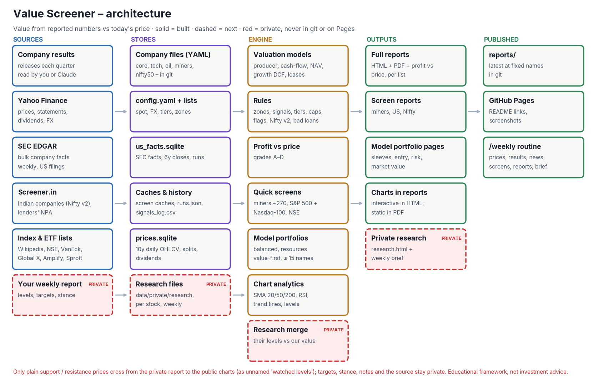
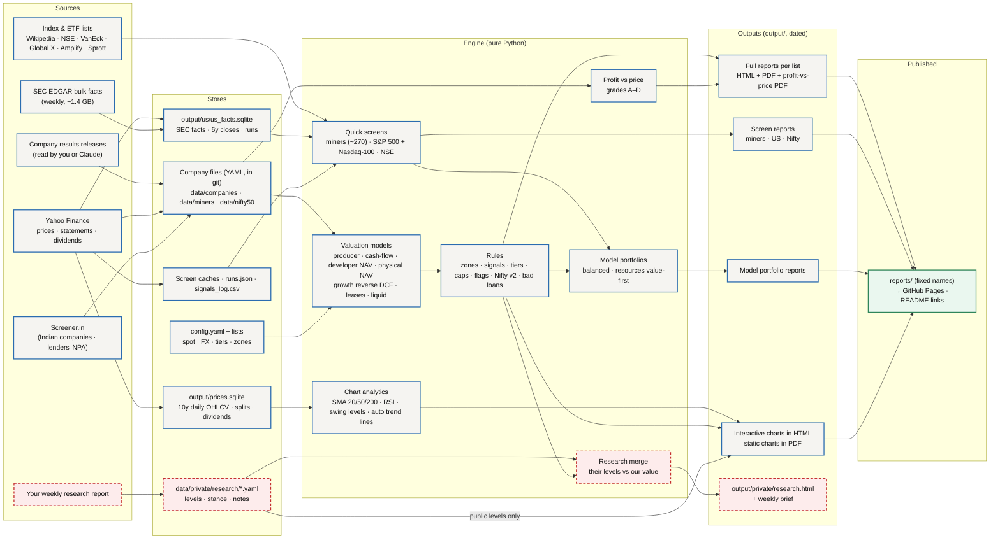
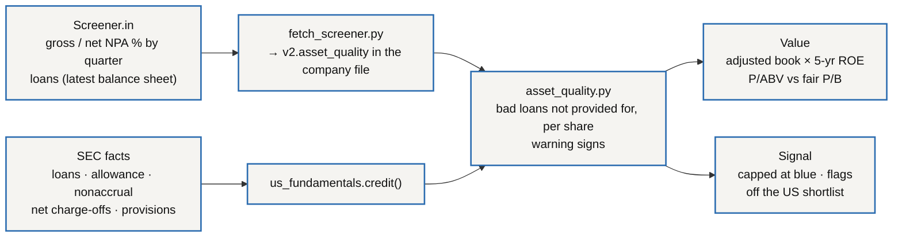
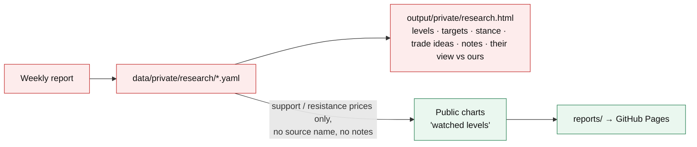
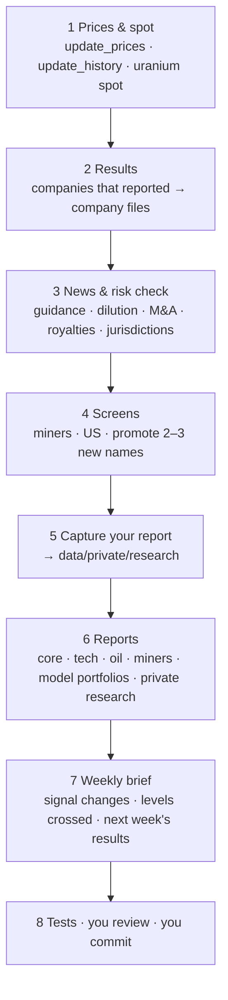
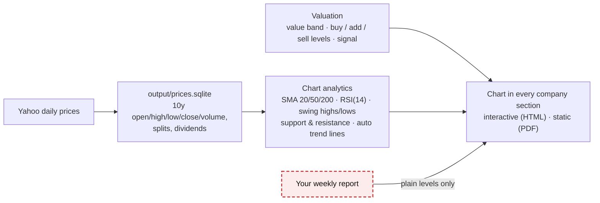

# Value Screener – architecture

What the system does, how the parts fit together, what is built and what is next. Updated 13 Nov 2026.
The original requirements and formulas are in [Value_Screener_Design.pdf](Value_Screener_Design.pdf); how to run
everything is in the [README](../README.md); how companies are valued, in plain English, is in
[Valuation_Overview.pdf](Valuation_Overview.pdf) (short) and [Valuation_Guide.pdf](Valuation_Guide.pdf) (detailed).

**Legend:** solid boxes are built and in use · dashed boxes are agreed and next · the red area is private and never
leaves your machine (git ignores it and the publish step refuses it).

## 1. The idea in one line

Value from the latest **reported** numbers (no forecasts, no targets), compared with today's **price** – the Rick Rule
way – with a margin of safety before buying, and the same rules applied every time.

## 2. The whole system

## 3. Layers

### Sources
| Source | What it gives | Used by | How often |
|---|---|---|---|
| Company results releases | production, realised prices, AISC, earnings, D&A, sustaining capex, cash, debt | full company files | each quarter, via `update_results.py` or in chat |
| Yahoo Finance (yfinance) | prices, statements, dividends, FX | prices, quick screens, profit vs price, model portfolios, price history (next) | daily |
| SEC EDGAR bulk "company facts" | official US filings, incl. lenders' loans, allowance, nonaccrual loans, charge-offs | S&P 500 / Nasdaq-100 screen | weekly |
| Screener.in | Indian consolidated figures (Nifty v2); for lenders, quarterly gross / net NPA % (standalone page for banks) and loans | Nifty 50 company files | quarterly |
| Wikipedia, NSE, ETF providers | index and ETF membership | universes for the quick screens | when refreshed |
| Your weekly research report | support / resistance, targets, stance, notes | private research report; plain levels on public charts | weekly, **private** |

### Stores
| Store | Contents | In git? |
|---|---|---|
| `data/companies/*.yaml`, `data/miners/companies`, `data/nifty50/companies` | one file per company: the reported quarter, shares, balance, metals, sources, assumptions | yes |
| `data/lists/*.yaml`, `data/etfs/*.yaml`, `config.yaml` | lists, ETF look-throughs, spot, FX, tiers, zones, multiples | yes |
| `output/us/us_facts.sqlite` | SEC facts with filing dates (point-in-time), 6 years of closes, splits, each run's verdicts | no (rebuildable) |
| `output/*/screen_cache`, `runs.json`, `signals_log.csv` | cached Yahoo figures, previous-run figures, signal history | no |
| `output/prices.sqlite` | 10 years of daily open/high/low/close/volume, splits, dividends, currency – core, tech, oil, promoted miners | no (rebuildable, ~12 MB) |
| `data/private/research/<date>.yaml` | each weekly report captured per stock and metal | **no – private** |

### Engine (`valuescreen/`)
| Module | Job |
|---|---|
| `loader.py` | read and validate company files, lists, config; last-12-month earnings; tiers; publish to `reports/` |
| `models.py`, `leases.py` | the valuation models (producer / streamer / royalty, oil cash-flow, developer NAV, physical NAV, growth reverse DCF at 10% US / 12% India, contracted leases, liquid assets) |
| `rules.py`, `v2.py` | zones, signals (green / blue / red), buy and add levels, caps, flags, stale-data check; Nifty v2 earnings rules |
| `asset_quality.py` | bad loans at banks and other lenders: adjusted book value, warning signs that cap at blue (India and US) |
| `profit_vs_price.py`, `growth_data.py`, `screener.py` | profit growth vs price growth and its A–D grade; Yahoo and Screener.in fetching |
| `miner_screen.py`, `etf_holdings.py` | miners quick screen from ETF holdings |
| `us_screen.py`, `us_fundamentals.py`, `us_universe.py`, `sec.py`, `factsdb.py` | S&P 500 / Nasdaq-100 screen from SEC figures, with its database |
| `model_portfolio.py` | candidates from every screen, value / quality / momentum scores, sleeves, sizing, report |
| `technicals.py`, `prices.py`, `history.py` | 200-day average, RSI, MACD; live prices; previous-run figures |
| `pricedb.py` | the price-history database: bars, splits and dividends, weekly / monthly resampling |
| `chart_levels.py`, `price_chart.py` | SMA 20/50/200, RSI(14), swing highs and lows, support / resistance, automatic trend lines; the chart data for HTML and the static chart for PDF |
| `research.py` | private: the weekly capture's levels, rules and stance against today's price and our valuation; the private report |

### Outputs (`valuescreen/`)
| Module | Output |
|---|---|
| `html_report.py` | the full report per list: summary table, company sections, profit vs price, links |
| `pdf.py`, `charts.py`, `style.py`, `wording.py` | bookmarked PDF with charts; one look (Inter, palette); the words in every report |
| `report.py` | ranked CSV, signal log, heatmaps |
| `html_report.chart_block` + `vendor/` | per company: RSI on top, candles (D / W / M, 6M–10Y), SMA 20/50/200, nearest auto support / resistance (all on request) and trend lines, value / buy / add / sell lines, E / D / S markers (Lightweight Charts, Apache 2.0) |

### Commands (`tools/` and `python -m valuescreen`)
| Command | Does |
|---|---|
| `python -m valuescreen run --list <core/tech/oil/miners/nifty50> --live` | full valuations → HTML + PDF + profit-vs-price PDF, published to `reports/` |
| `update_prices.py`, `update_results.py`, `fetch_screener.py`, `add_companies.py` | keep company files current |
| `screen_miners.py [--promote]`, `screen_us.py`, `screen_universe.py`, `make_etf_list.py`, `make_nse_list.py` | quick screens and their universes |
| `model_portfolio.py` | the two model portfolios |
| `update_history.py` | load and update the price history |
| `research.py` | build the private research report (`output/private/research.html`) |
| `weekly.py` · `/weekly` | the whole routine and the weekly brief; the Claude Code skill adds results updates, the news check and the research capture |

## 4. Banks and other lenders

A lender's book value and earnings are only as good as its loans, so financials get one more step after the v2 rule
(average of 12-month EPS and book value × 5-year ROE, no net cash):

| | India (Nifty 50) | US (S&P 500 / Nasdaq-100 screen) |
|---|---|---|
| Bad loans taken off book | net NPA % × loans | nonaccrual loans − allowance, if positive (CECL already reserves lifetime losses) |
| Warning signs (cap at blue) | net NPA > 2%, gross NPA > 5%, coverage < 60%, gross NPA up > 0.5 pts in 4 quarters | nonaccrual > 2% of loans, allowance < nonaccrual, net charge-off rate up > 50% on a year earlier |
| Data quirks | banks fill NPA rows only on the standalone page; Screener's "Loans n Advances" is used only when ≥ 40% of assets, else Other Assets − cash (an upper bound) | not every bank tags nonaccrual loans or charge-offs (e.g. WFC, AXP); missing figures mean no check, not a pass |
| Thresholds | `asset_quality` in `config.yaml` | same block |

Capital ratios (CAR / CET1) are in neither source, so they are still checked by hand.

## 5. Public and private

- `data/private/` and `output/private/` are in `.gitignore`; `loader.publish` refuses any path under them.
- On public charts only plain support and resistance prices appear, as dashed "watched levels" with no source named.
  Targets, stops, stance, trade ideas, thesis and the source stay private. A level can be forced either way with
  `public: true / false` in the weekly file.
- Holdings quantities and cost basis, if ever added, are private too.

## 6. The weekly routine (`tools/weekly.py`, `/weekly`)

## 7. Status

| Area | Status |
|---|---|
| Valuation models, rules, tiers, signals, flags (Valuation Playbook) | built |
| Bad loans for lenders – adjusted book, NPA / nonaccrual / charge-off warning signs (Nifty 50 and US screen) | built |
| Full reports per list – HTML with navigation, PDF, profit-vs-price PDF | built |
| Lists: core, tech, oil, miners (promoted: BTG, KGC, OGC), Nifty 50 | built |
| Miners quick screen from seven ETFs (~270) | built |
| S&P 500 / Nasdaq-100 screen from SEC figures, with database | built |
| Model portfolios: balanced, resources value-first (≤ 15 names, market value) | built |
| Publishing: latest reports at fixed names on GitHub Pages, README links and screenshots | built |
| **Stage 1** – price history for core, tech, oil and promoted miners (49 symbols, 10 years daily) | built |
| **Stage 2** – charts in the public reports: candles, SMA 20/50/200, RSI, volume, auto trend lines and levels, value / buy / add / sell lines, E / D / S markers (watched levels follow with stage 3) | built |
| **Stage 3** – private research: weekly capture, private report (rules near / triggered, agree / conflict with our valuation, charts with their levels), plain watched levels on public charts | built |
| **Stage 4** – weekly routine: `tools/weekly.py` (all steps + brief) and the `/weekly` skill (results, news, capture) | built |
| Later – capital ratios for lenders (CAR / CET1: not in Screener.in or the SEC bulk facts), US tangible book (less goodwill) | ideas |
| Later – Markets page (ratios such as SILJ/GDXJ, URNM/GLD, gold/silver; weekly and YTD change), "after a sell-off" forward returns, signal scorecard, thesis tracker, price history for Nifty 50 and the S&P 500 | ideas |

## 8. Principles

- **Reported numbers only.** Every figure in a company file has a source; anything not in the source is marked ASSUMED.
- **Quick screens filter, full files decide.** A quick-screen green means "make a full company file", never "buy".
- **The same rules every time.** Thresholds live in `config.yaml`, not in judgement on the day.
- **Rebuildable data stays out of git.** Databases and caches can be downloaded again; only inputs and published
  reports are committed.
- **Private stays private.** Paid research and personal holdings never reach the public repo or Pages.
- **Educational framework, not investment advice.**

## 9. Technical analysis – what exists and what is being built

**Valuation decides *what* to buy and at what price; technical analysis only helps decide *when* and *how much*.**
A chart never turns an expensive company into a buy, and a cheap company is not sold because its chart looks weak.
Technical analysis studies the price itself: its trend, its momentum, and the levels where buyers and sellers have
turned it before.

### Built today
| Where | What it does |
|---|---|
| `valuescreen/technicals.py` (`run --technicals`) | "Before buying" line in each company section: price against its 200-day average, RSI(14), MACD. Below the 200-day average → "buy in thirds" |
| `model_portfolio.py` | Momentum sets the entry: at or above 95% of the 200-day average with a positive 6-month return = full position; otherwise start with a third. Also 1-year volatility and worst fall for sizing and risk |

### Built in stages 1–2, and next (stage 3)

| Piece | Detail |
|---|---|
| **Price history** (stage 1 – built) | `valuescreen/pricedb.py`, `tools/update_history.py`: 10 years of daily open, high, low, close, volume, splits and dividends for core, tech, oil and the promoted miners (~55 tickers, ~10 MB, not in git); later Nifty 50 and the S&P 500 |
| **Indicators** | Simple moving averages 20 / 50 / 200 days; RSI(14) with 70 / 30 lines; volume; MACD kept in the "before buying" line |
| **Levels and trend lines** | Swing highs and lows found by code; horizontal support and resistance where price turned several times, labelled with the price; a falling line through lower highs and a rising line through higher lows – drawn only when the fit is clean, marked "auto" |
| **Our valuation on the chart** | Shaded 12x–15x value band, buy and add lines, start of the sell zone, today's signal badge, results (E) and dividend (D) markers |
| **Watched levels** (stage 3) | Plain support / resistance prices from your private weekly report, dashed and unnamed; everything else from that report stays private |
| **The chart** (stage 2 – built) | Daily / weekly / monthly, 1–10 years, crosshair with open, high, low, close and volume; TradingView's open-source Lightweight Charts embedded in the HTML report (works offline and on GitHub Pages); a static version in the PDF |
| **Later** | Markets page (ratios such as SILJ/GDXJ, URNM/GLD, gold/silver; weekly and YTD change); "after a sell-off" forward returns; a scorecard of whether signals and levels worked |

### The terms
| Term | Meaning | How it is used here |
|---|---|---|
| Moving average (SMA 20 / 50 / 200) | Average closing price of the last 20, 50 or 200 days | Above a rising 200-day = long-term uptrend. Below it = buy in thirds, not all at once |
| RSI(14) | 0–100 gauge of how strong recent gains were against losses | Under 30 = oversold (often a better entry for a cheap company); over 70 = overbought (wait for a pullback) |
| MACD | Gap between a fast and a slow average, and its own trend | Rising = momentum improving |
| Support / resistance | Prices where the share has repeatedly stopped falling / rising | Places to start or add (support), or where a rally may stall (resistance) |
| Trend line | A line through rising lows or falling highs | Shows whether the trend is still intact |
| Volume | Shares traded each day | Moves on high volume matter more than on thin trading |
